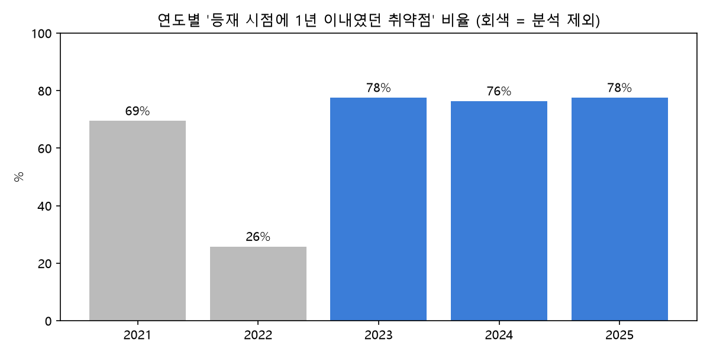
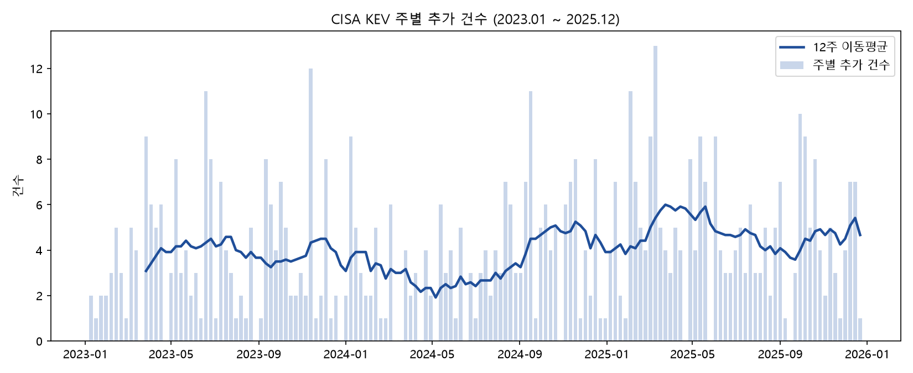
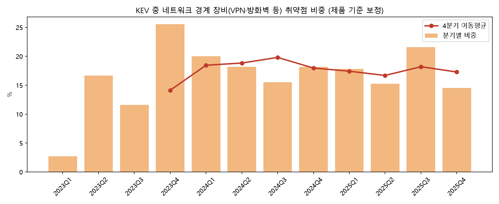
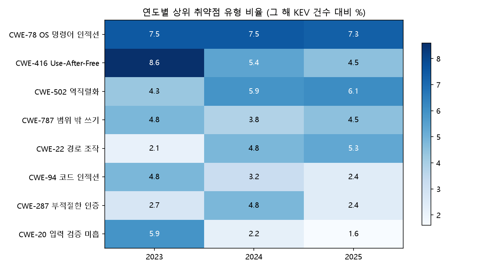

# 실제로 악용된 취약점은 어디로 향하고 있나: CISA KEV 시계열 분석 (2023.01 ~ 2026.09)

> ✏️ 표시는 초안이에요. 해석과 결론은 직접 읽고 본인 말로 고쳐 쓰세요. (미션 조건: 최종 판단은 본인이 근거를 들어 설명)

## 1. 분석 주제 및 선정 이유

- 정보보안 공부를 하면서 "취약점은 매일 수천 개씩 나오는데, **그중 실제 공격에 쓰이는 건 무엇인가?**"가 궁금했다.
- 미국 CISA의 KEV(Known Exploited Vulnerabilities) 목록은 "실제 악용이 확인된 취약점"만 모아 둔 공식 목록이라, 이 질문에 가장 직접적으로 답할 수 있는 데이터다.
- 보안 컨설팅(취약점 진단) 진로를 준비하는 입장에서, **무엇을 먼저 점검하고 공부해야 하는지** 데이터로 우선순위를 확인하고 싶었다.

## 2. 분석 질문

1. **추세**: 실제 악용되는 취약점이 KEV에 추가되는 속도는 빨라지고 있는가?
2. **표적**: VPN·방화벽 같은 네트워크 경계 장비 취약점은 얼마나 큰 비중을 차지하고, 그 비중은 변하고 있는가?
3. **유형**: 어떤 취약점 유형(CWE)이 반복해서 악용되며, 최근(2026년) 달라진 유형은 무엇인가?

## 3. 데이터 설명

| 항목 | 내용 |
|---|---|
| 출처 | CISA Known Exploited Vulnerabilities Catalog (cisa.gov/known-exploited-vulnerabilities-catalog), GitHub 사본 cisagov/kev-data |
| 수집일 | 2026-10-27 (원본 CSV를 `data/`에 그대로 저장) |
| 원본 기간 | 2021-11-03 ~ 2026-10-26, 1,758건 |
| 분석 기간 | 2023-01-01 ~ 2026-09-30, 864건 |
| 주요 컬럼 | `cveID`, `vendorProject`(제조사), `product`, `dateAdded`(KEV 추가일), `cwes`(취약점 유형) |
| 시계열 단위 | **주 단위, 194개 데이터 포인트** |

**집계 단위를 주(週)로 정한 이유**: 월 단위는 45개 포인트뿐이라 미션 기준(100개 이상)에 못 미치고, 일 단위는 추가가 없는 날이 대부분이라 노이즈가 너무 크다. 주 단위는 194개 포인트를 확보하면서 변화가 잘 보인다. 비중 분석(질문 2)은 주별 건수가 적어 **분기** 단위로 집계했다.

### 3-1. 데이터 정제 기준

**이상치: 초기 일괄 등록 구간 제외 (2021.11 ~ 2022.12)**
- 관찰: KEV가 처음 만들어진 2021-11-03 하루에만 287건이 추가됐고, 2022년에도 하루 95건(3/3), 66건(3/25) 같은 대량 추가가 있었다.
- 2022년에 추가된 취약점 중 등재 시점에 1년 이내였던 비율은 26%뿐인 반면, 2023년부터는 76~82%로 안정적이다(그래프 0).
- 판단: 2021~2022년은 "새로 악용된 취약점"이 아니라 **과거 취약점을 목록에 채워 넣은 구간**이므로, 추세 분석에서 제외했다.



**결측치**
- `cwes`(취약점 유형) 컬럼만 결측이 있다: 전체 175건, 분석 기간 내 연도별 3.7~11.8%.
- 처리: 삭제하지 않고 유지. 질문 3의 비율은 "그 해 KEV 전체 건수 대비"로 계산했기 때문에, 결측이 많은 해(2023, 2025)는 유형 비율이 조금 낮게 나올 수 있다.
- 추가가 한 건도 없던 주(13주)는 결측이 아니라 **실제 0건**이므로 0으로 채웠다.

**기간 끝 처리**
- 2026년 10월은 아직 끝나지 않은 달이라 제외했고, 주별 그래프에서도 7일이 다 차지 않은 마지막 주는 제외했다.
- 2026년은 1~9월만 있으므로 연도 비교는 **모든 연도를 1~9월로 맞춰서** 했다.

**다중 집계**
- 하나의 CVE에 CWE가 여러 개 붙은 경우 각각 1회씩 셌다. 그래서 유형별 비율을 모두 더하면 100%를 넘을 수 있다.

## 4. 분석 결과 및 시각화

적용한 시계열 기법: **이동평균**(12주, 4분기), **변화율**(전년 대비 %, 비중은 %p), **구간별 통계**(연도별 주간 평균·표준편차·최대), **기간별 집계**(주·분기·연도).

### 4-1. 질문 1: 추가 속도는 빨라지고 있는가



| 연도 | 1~9월 건수 | 전년 대비 | 주 평균 | 주 표준편차 | 주 최대 |
|---|---|---|---|---|---|
| 2023 | 140 | - | 3.67 | 2.91 | 12 |
| 2024 | 131 | -6.4% | 3.51 | 2.59 | 11 |
| 2025 | 183 | +39.7% | 4.71 | 2.97 | 13 |
| 2026 | 246 | +34.4% | 6.42 | 3.45 | 14 |

- 12주 이동평균은 2024년 상반기에 주 2~3건으로 가장 낮았다가, 2024년 하반기부터 올라가 2026년 9월에는 주 8건 수준이 됐다.

### 4-2. 질문 2: 네트워크 경계 장비의 비중



| 연도 | 경계 장비 비중 | 전년 대비 |
|---|---|---|
| 2023 | 17.1% | - |
| 2024 | 22.6% | +5.5%p |
| 2025 | 21.6% | -0.9%p |
| 2026 (1~9월) | 19.9% | -1.7%p |

- 4분기 이동평균은 2024년 이후 **18~25% 사이**에서 움직인다.
- 경계 장비 중 많이 등장한 제조사: Cisco 39건, Ivanti 26건, Fortinet 21건, Citrix 15건, D-Link 14건, Palo Alto Networks 11건.
- 2023년 1분기 2.7%는 해당 분기 전체가 37건으로 적어서 생긴 값이라 해석에서 비중을 두지 않았다.

### 4-3. 질문 3: 반복되는 유형과 달라진 유형



- **꾸준히 상위**: OS 명령어 인젝션(CWE-78)은 4년 내내 5~7.5%, 역직렬화(CWE-502)는 4.3% → 5~6%대.
- **줄어든 유형**: Use-After-Free(CWE-416)는 8.6% → 5.4% → 4.5% → 2.8%로 계속 감소.
- **2026년에 커진 유형**: 코드 인젝션(CWE-94) 2.4% → 7.3%, 부적절한 인증(CWE-287) 2.4% → 6.5%, 인증 누락(CWE-306) 2.4% → 4.9%.

## 5. 인사이트

### 인사이트 1. 실제 악용 취약점의 등재 속도가 2025년부터 빨라졌다
- **관찰(Fact)**: 1~9월 기준 2024년 131건 → 2025년 183건(+39.7%) → 2026년 246건(+34.4%). 주 평균도 3.51건 → 6.42건으로 거의 두 배.
- **원인(Why, 가설)** ✏️: ① 실제 공격 자체가 늘었을 가능성. ② 반례 가능성: CISA의 등재 정책이나 처리 능력이 바뀌어도 같은 그래프가 나온다. 최근 항목의 `notes`에 2026년 새 지침(BOD 26-04)이 언급돼 있어, 정책 변화의 영향일 수도 있다. **이 데이터만으로는 둘을 구분할 수 없다.**
- **행동(Action)** ✏️: "실제 악용 여부"를 기준으로 패치 우선순위를 정하는 관리 방식이 점점 중요해진다. 취약점 진단 결과를 보고할 때 KEV 등재 여부를 함께 표시하는 것을 고려할 만하다.

### 인사이트 2. 네트워크 경계 장비는 "늘고 있다"기보다 "늘 5건 중 1건"이다
- **관찰(Fact)**: 경계 장비 비중은 2024년 22.6%로 오른 뒤 21.6%, 19.9%로 비슷한 수준을 유지했다. 4분기 이동평균은 18~25% 범위.
- **원인(Why, 가설)** ✏️: VPN·방화벽은 인터넷에 직접 노출돼 있고 내부망으로 들어가는 입구라서, 공격자가 꾸준히 노리는 대상이라고 볼 수 있다.
- **행동(Action)** ✏️: 처음 예상한 "증가 추세"는 데이터로 확인되지 않았다. 대신 **비중이 꾸준히 높다**는 점이 더 중요하다. 진단 시 외부에 노출된 경계 장비의 버전·패치 상태를 우선 점검 항목으로 둔다.

### 인사이트 3. 2026년에는 '인증'과 '코드 실행' 취약점이 커지고, 메모리 취약점은 줄었다
- **관찰(Fact)**: CWE-94(코드 인젝션) 2.4% → 7.3%, CWE-287(부적절한 인증) 2.4% → 6.5%, CWE-306(인증 누락) 2.4% → 4.9%. 반면 CWE-416(Use-After-Free)는 2023년 8.6%에서 2026년 2.8%로 감소.
- **원인(Why, 가설)** ✏️: 인증을 건너뛰고 바로 코드를 실행하는 취약점은 공격자 입장에서 가장 효율적이라 선호될 수 있다. 메모리 취약점 감소는 브라우저·OS의 방어 기술 강화 영향일 수 있다. 단, 2026년은 9개월치이고 한 CVE에 287·306이 함께 붙은 경우도 있어 과대 해석에 주의.
- **행동(Action)** ✏️: 웹 진단·학습 시 **인증 우회, 명령어·코드 인젝션, 역직렬화**를 우선 항목으로 둔다. (내 학습 계획의 드림핵 Web Hacking·Secure Coding 우선순위와도 일치)

## 6. 결론 및 한계점

### 결론 ✏️
1. 실제 악용되는 취약점의 KEV 등재는 2025년부터 연 35~40%씩 빨라지고 있다.
2. 네트워크 경계 장비는 꾸준히 전체의 약 20%를 차지하는 고정적인 표적이다.
3. 2026년에는 인증 우회와 코드 실행 계열이 커졌고, 메모리 취약점은 줄었다.

### 한계점
- **미국 기준 목록**: CISA가 미국 연방기관 관점에서 확인한 취약점이라, 국내 환경과 다를 수 있다.
- **추가일 ≠ 악용 시작일**: `dateAdded`는 CISA가 목록에 올린 날이지 공격이 시작된 날이 아니다.
- **정책 영향 구분 불가**: 건수 변화가 실제 공격 증가인지 CISA 운영 변화인지 이 데이터만으로는 알 수 없다.
- **경계 장비 분류는 수작업**: 제조사 기준으로 분류해서, 경계 장비가 아닌 제품(예: Cisco의 다른 소프트웨어)이 섞였을 수 있다. 분류 목록은 `analysis.py`의 `EDGE_VENDORS`에 공개했다.
- **CWE 결측·다중 집계**: 결측(연 3.7~11.8%)과 다중 집계 때문에 유형 비율은 근사치다.
- 랜섬웨어 악용 여부 컬럼은 최근 항목일수록 확인이 늦게 반영되는 경향이 있어 분석에서 제외했다.

## 7. AI 사용 로그

| 사용 작업 | 사용 이유 | 검증 방법 |
|---|---|---|
| 분석 주제 선정 (Claude) | CVE 전체 분석이 미션 기간에 비해 너무 커서, 범위가 작고 정제된 데이터 후보를 찾기 위해 | 후보 2개(KEV, 네이버 데이터랩)를 비교하고 직접 KEV 선택 |
| 데이터 탐색·이상치 발견 (Claude) | 초기 일괄 등록 구간을 빠르게 찾기 위해 | 원본 CSV에서 2021-11-03 행 수(287건)를 직접 확인 ✏️ |
| 분석 코드·그래프 작성 (Claude) | 시간 절약 | ✏️ 아래 체크리스트 수행 후 결과 기록 |
| 리포트 초안 (Claude) | 수치 정리와 문장 구성 | 원인·행동 부분은 직접 다시 씀 ✏️ |

**검증 체크리스트** ✏️ (직접 하고 결과를 적기)
- [ ] `python analysis.py`를 내 PC에서 실행해 그래프와 수치가 리포트와 같은지 확인
- [ ] 무작위 CVE 5건을 골라 CISA KEV 웹사이트에서 추가일·제조사가 CSV와 같은지 대조
- [ ] 엑셀에서 CSV를 열어 연도별 건수(피벗)가 표의 값과 같은지 대조
- [ ] 경계 장비로 분류된 항목 10건을 훑어 실제로 VPN·방화벽 제품인지 확인하고 오분류 건수 기록

## 부록: 실행 방법

```bash
pip install -r requirements.txt
python analysis.py
```
실행하면 `images/`에 그래프 4개가 저장되고, 리포트에 쓴 수치가 콘솔에 출력된다.
